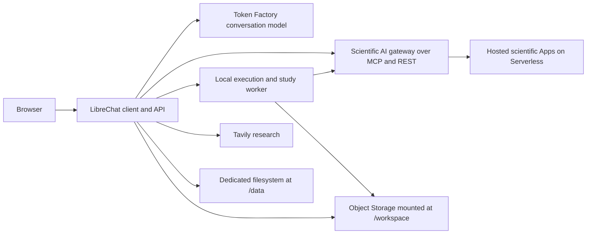

# Scientific AI system architecture

Scientific AI is a research workbench built on LibreChat. A conversational model
plans work, hosted Scientific AI Apps perform inference or simulations, and local
tools prepare inputs, analyze outputs, and deliver files and inline reports.

This guide describes the customer client and its integration boundaries at source
revision `8d629cf49152e5d2d9e0677209b200ccc54190d3`, reviewed on 2026-10-21.
Source, selected release image, and running customer instances have independent
versions. This source review does not establish the state of a live deployment.

## Repository scope

The maintained repository is `rene-tech/serverless-ai-cookbook`, branch `main`.
It also contains general Serverless examples and older workbenches.

| Area | Role |
| --- | --- |
| [templates/hcls-librechat](../templates/hcls-librechat/README.md) | Current LibreChat client, UI overlays, server patches, local execution, analysis helpers, and deployment scripts |
| [skills/scientific-ai](../skills/scientific-ai/README.md) | Canonical portable scientific instructions, references, scripts, manifest, and checksummed bundle |
| [life-science/bionemo-librechat](../life-science/bionemo-librechat/) | Earlier integration and shared helpers still copied into the current image; inspect Dockerfile dependencies before removing anything |
| [Older HCLS architecture](hcls-serverless-architecture.md) | September 8 standalone compute APIs and earlier workbench baseline |
| [Development workflow](development-workflow.md) | Detached task worktrees, serialized integration, validation, and publication to the personal fork |

The Scientific AI gateway and its model scheduling are external dependencies of
this client. This directory does not implement the entire hosted platform.

## Runtime topology



The client runs on a CPU Serverless endpoint, normally port `3080`. Scientific
models are centrally hosted Apps authorized by the platform key; deploying a
workbench does not deploy a private model fleet.

The [Dockerfile](../templates/hcls-librechat/Dockerfile) starts from a pinned
LibreChat image. It copies replacement React components into that image, applies
patches to the existing client/server, builds the frontend, and installs scientific
Python environments and helpers. This checkout is an overlay, rather than a full
vendored LibreChat source tree. Many patches check exact upstream source anchors
and fail if they no longer match, so a LibreChat base upgrade needs compatibility
checks. Dated `Dockerfile.*` files also describe additive release images; they are
not interchangeable recipes for the current release.

### Startup

The process chain is `tini` → state supervisor → shell entrypoint → study
supervisor, which launches the LibreChat API and the enabled study worker.

1. [state-supervisor.py](../templates/hcls-librechat/state-supervisor.py) validates
   persistent `/data`, takes the instance lock, handles configured upgrade
   snapshots/restoration, and links uploads to persistent storage.
2. [entrypoint.sh](../templates/hcls-librechat/entrypoint.sh) loads or creates
   persistent encryption/JWT secrets, renders configuration, starts local MongoDB,
   and seeds managed agents and the optional initial account.
3. [scientific-study-worker.py](../templates/hcls-librechat/scientific-study-worker.py)
   supervises the API and advances eligible saved studies when ownership mode is
   configured. Study work continues independently of browser connections and
   individual chat turns.

Managed agent updates use [seed-merge.cjs](../templates/hcls-librechat/seed-merge.cjs)
to preserve customer edits while updating untouched defaults. Startup seeding is
not an instruction to reset existing accounts or replace their agents.

## Conversation and tools

[render-config.mjs](../templates/hcls-librechat/render-config.mjs) defines model
choices and MCP connections. [seed-workbench.js](../templates/hcls-librechat/seed-workbench.js)
maintains the `agent_nebius_scientific_ai` agent and tutorial agents.
[agent-instructions.md](../templates/hcls-librechat/agent-instructions.md) defines
the main agent's execution and result-delivery behavior.

The approved conversational default is `moonshotai/Kimi-K3` through public
Nebius Token Factory. Provider changes follow [CHAT_MODEL_POLICY.md](../templates/hcls-librechat/CHAT_MODEL_POLICY.md).
OpenAI and Anthropic are optional with user credentials. Changing the chat model
does not remove the scientific tools or change the caller's App grants.

| MCP connection | Transport and responsibility |
| --- | --- |
| `scientific-ai-apps` | Remote streamable HTTP; caller-authorized App discovery, schemas, submission, and operation tools |
| `scientific-demos` | Local Node stdio; Apps catalog, run observation, workspace information, deterministic analysis, Clinical Report, and MindEval |
| `environment-execution` | Local Python stdio; durable command execution, workflow composition/submission/observation, uploads, and verified result delivery |
| `structure-viewer` | Local stdio; bounded structure and workspace-media viewers |
| `tavily` | Local Node stdio bridge to Tavily research |

For a full catalog, `workbench_list_apps` returns the caller's complete compact
list. `workbench_search_apps` is a separate literal search. An empty search result
does not prove missing permission. For a selected App, load its current schema
and exact typed tool through deferred discovery. A skill or catalog entry alone
does not prove runtime readiness or scientific validity.

Chat model time is bounded separately from scientific execution. The configured
defaults are 90 seconds per model invocation and 300 accumulated model seconds
per turn, with repeated-tool-loop limits. A paused chat does not cancel or
resubmit an admitted scientific job.

## Scientific execution and recovery

The main path for a multi-step request is:

1. Load the relevant skill and resolve scientific choices. Inspect actual input
   files and the selected App's live schema.
2. Prepare a `scientific-workflow/v2` plan with native or batch model steps,
   dependent preparation/analysis, and requested reports. The typed tools in
   [execution-mcp.py](../templates/hcls-librechat/execution-mcp.py) validate and
   submit the plan with its output directory.
3. [scientific_study.py](../templates/hcls-librechat/scientific_study.py) freezes
   the plan, records owner/caller identity and input hashes, and stores durable
   receipts. The worker advances phases through the existing
   [workflow runner](../templates/hcls-librechat/scientific-workflow.py).
4. Trusted file helpers upload actual bytes, calculate size/SHA-256, finalize
   artifacts, and build the required manifests. Batch submission and recovery
   share [scientific-batch-acceptance.py](../templates/hcls-librechat/scripts/scientific-batch-acceptance.py),
   installed as `/opt/bionemo/invoke-scientific-batch.py`.
5. Observe the original operation, verify returned artifacts, run the declared
   analysis, and deliver measured results with authenticated workspace links.

Local command executions and saved workflow receipts have their own internal
identities. Only native `op-…` values represent Serverless jobs. A saved plan is
not evidence of platform admission; a workflow may eventually contain several
native operations. Whole-workflow observation uses its saved `output_directory`.

Retries retain the same immutable inputs, output directory, idempotency keys,
and admitted operation IDs. Observation errors remain separate from scientific
failure. An unknown submission outcome requires reconciliation, not an automatic
replacement submission. The [observation recovery guide](../templates/hcls-librechat/docs/client-observation-recovery-20261020.md)
documents the read-only `--observe-output` recovery command and exit codes.

The current instructions require an explicit optional `md-precheck` offer before
a new GROMACS simulation, with the exceptions defined in the
[md-precheck skill](../skills/scientific-ai/md-precheck/SKILL.md). This is part of
the agent's workflow contract, separate from platform admission.

## User interface and result delivery

[ScientificLanding.tsx](../templates/hcls-librechat/ScientificLanding.tsx) provides
six research entry points. Selecting a card prepares an editable prompt; it does
not submit inference. The workbench at `/demos` contains Apps, Runs, Workspace,
Getting started, Clinical Report, and MindEval.

[Demos.tsx](../templates/hcls-librechat/demos/Demos.tsx) uses the authenticated
[router](../templates/hcls-librechat/demos/router.cjs), backed by
[service.cjs](../templates/hcls-librechat/demos/service.cjs). The service handles
catalog projection, operation observation, saved results, workspace files, and
clinical jobs. Runs reads caller operation history and reconnects to existing
work. Progress distinguishes measured work from durably checkpointed work and
keeps stale or unknown values explicit.

Trusted file helpers transfer bulk artifact bytes outside the model context.
Structure viewers render real coordinates; report previews display bounded content in sandboxed frames.
Verified workspace links support inline viewing and authenticated downloads.
The ordinary LibreChat attachment picker is not automatically a scientific
artifact bridge. Use the Workspace/file tools for model inputs.

Clinical Report produces source-linked drafts and review artifacts. MindEval
drives backend consultation/evaluation workflows. Their UI and transport
qualification do not establish clinical validity.

## Storage and identity

| Location or identity | Responsibility |
| --- | --- |
| `/data` | Dedicated POSIX filesystem for MongoDB, accounts, chats, encryption keys, uploads, execution state, and upgrade snapshots |
| `/workspace` | Mounted Object Storage for scientific inputs, outputs, scripts, examples, and owner-namespaced study receipts |
| LibreChat login | Account and conversation access within the client |
| Scientific AI key | Gateway caller identity, App grants, and concurrency policy |
| Token Factory and Tavily keys | Separate conversational inference and research credentials |

Object Storage is not a POSIX filesystem or a MongoDB backup. Helpers use private
seekable scratch where necessary, publish closed files, and verify readback.
One active client owns each `/data` filesystem. Durable studies also require a
stable owner namespace and one active supervisor for that owner.

The supported default is a dedicated client per user; users may intentionally
share a tenant bucket. Explicitly shared clients also exist, but separate logins
do not create separate inference identities when they use one platform key.
Local command execution runs in the privileged client environment, so this is
not an isolated sandbox for mutually untrusted users.

Deployment credentials use secret environment bindings. Personal panel/MCP keys
use LibreChat's encrypted credential store; explicitly enabled shared-key mode
can use the deployment key. Preserve both database state and encryption material
when replacing an instance. See [customer lifecycle](../templates/hcls-librechat/docs/serverless-customer-lifecycle.md)
for the complete ownership, replacement, and recovery procedure.

## Skills and release state

[skills/scientific-ai/manifest.json](../skills/scientific-ai/manifest.json) is the
canonical skill inventory. The bundle is installed at `/app/skill` in LibreChat
and can be installed into other MCP clients. Portable instructions do not install
the workbench's Python environments, local tools, or hosted models. The full
image separately includes a pinned ClawBio selection and runtime.

At the reviewed revision:

| Item | Recorded state on 2026-10-21 |
| --- | --- |
| Source bundle | `2026.10.21.1`, 38 canonical skills, 44 distinct mapped App identifiers |
| Locked inventory | 96 listed files; all recorded SHA-256 values matched the checkout |
| Selected client image | `observation-recovery-20261020-r1`, digest `sha256:de999b74fa47b0e1b5c9bb6b80ac90b4e1028d6f143069f52bcb63faa5310729` |
| Skills in the selected image | `2026.10.19.1` |
| New RFD4 skill | Integrated source; separate image and client activation qualification required |

The 44 mapped identifiers are a source inventory, not a live availability count.
Consult [release-image.sh](../templates/hcls-librechat/scripts/release-image.sh)
for the selected image and its linked receipt, and the
[RFD4 receipt](../templates/hcls-librechat/docs/rfd4-skill-20261021.md) for that
addition's activation boundary. Existing instances do not auto-upgrade when
`main`, a skill bundle, or the default image changes.

The [deployment helper](../templates/hcls-librechat/scripts/deploy.sh) creates the
CPU endpoint with its state filesystem, bucket mount, and secret references.
Git integration is separate from a live rollout. A controlled replacement must
preserve customer state, bindings, active jobs, and the prior image's provenance.

## Verification and maintenance

For a client change, check the affected source and installed image together:
frontend assets alone cannot establish compatibility with the API, MCP tools,
skills, and runtime helpers. Use the verification guidance in the
[client README](../templates/hcls-librechat/README.md#verify) and the dated release
receipt for the exact candidate.

The 2026-10-21 local review exercised catalog discovery, bounded operation waits,
progress projection, and managed-agent seed merging with these offline suites:

```sh
node --test --test-reporter=spec \
  templates/hcls-librechat/seed-merge.test.cjs \
  templates/hcls-librechat/demos/catalog.test.cjs \
  templates/hcls-librechat/demos/operation-wait.test.cjs \
  templates/hcls-librechat/demos/progress-contract.test.cjs
```

Result: 28 tests passed; one progress-card test could not run because the local
checkout lacked `typescript`. That test accepts `TYPESCRIPT_MODULE` pointing to
an installed TypeScript package. This was an offline subset, not a full client
build, hosted workflow qualification, or live deployment audit.

Keep this guide current when changing configuration, MCP boundaries, persistence,
or workflow ownership. Update the dated release snapshot from the manifest and
release selector; use their receipts for exact qualification claims.
